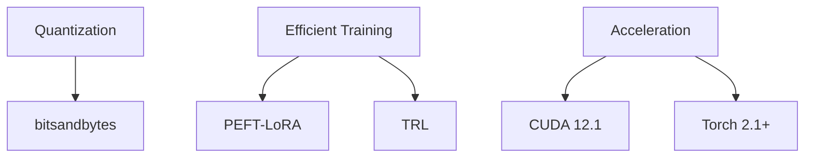

# 🚀 Supervised Fine-Tuning of Code LLMs on NVIDIA T4

## Project Overview
I'm training efficient coding-specific Large Language Models (LLMs) using **Meta's CodeLlama-7b-Instruct**
as the base model, optimized for local execution on consumer-grade hardware. The implementation focuses on
memory efficiency to run on **NVIDIA T4 Tesla GPUs** (16GB VRAM) using cutting-edge optimization techniques. 

 


## 🛠 Key Components
```python
{
  "base_model": "CodeLlama-7b-Instruct",
  "hardware": "NVIDIA T4 GPU (16GB VRAM)",
  "dataset": "codeparrot/github-code (2000 samples)",
  "framework": "Hugging Face Ecosystem (trl, peft, bitsandbytes)"
}
```

## 🧠 Memory Optimization Strategies

### Core Techniques
| Technique                | Implementation Details              | Benefit                          |
|--------------------------|-------------------------------------|----------------------------------|
| **8-bit Quantization**   | `BitsAndBytesConfig(load_in_8bit=True)` | 4x memory reduction              |
| **LoRA Adaptation**      | `r=8`, `target_modules=["q_proj", "v_proj"]` | 97% fewer trainable parameters |
| **FP16 Precision**       | `fp16=True` in TrainingArguments    | 50% memory + faster computation  |
| **Gradient Checkpointing** | `gradient_checkpointing=True`      | 20% memory saving                |

### Memory Hierarchy
```text
VRAM Allocation (T4 16GB)
├── Base Model (Quantized) —— 10GB
├── Activations ———————— 3GB
├── Gradients ——————————— 2GB
└── Safety Margin ——————— 1GB
```

## ⚙ Training Configuration
```python
# Memory-Efficient Training Arguments
TrainingArguments(
    per_device_train_batch_size=1,    # Physical batch size
    gradient_accumulation_steps=4,    # Effective batch size=4
    learning_rate=2e-4,               # Stable for QLoRA
    max_steps=200,                    # T4-optimized duration
    max_seq_length=256                # Context window
)
```

## 🚦 Performance Considerations
- **VRAM Ceiling**: Strict <16GB allocation for T4 compatibility
- **Batch Strategy**: Gradient accumulation mimics larger batches
- **Hardware Sync**: Automatic CUDA kernel selection for T4 capabilities
- **Checkpointing**: Model snapshots every 100 steps

## 📚 Technical Stack


## Validation boundary

This is a GPU notebook experiment. Training has not been rerun in this CPU-only
environment, and no held-out capability retention score is established here.
Run the CodeLlama and TinyLlama cells as separate experiments: each loads its
own model and data. The Alpaca lane now builds its text column from
instruction/input/output, and both lanes save the trained adapter and tokenizer
so the output can be reloaded instead of being lost when the session ends.

The notebook uses the older SFTTrainer API (`tokenizer`, `dataset_text_field`,
`max_seq_length`). Match that API when installing TRL; the unpinned Colab install
cells need a compatibility review before a reproducible GPU run. Final training
demos require saved adapter reload plus a held-out evaluation, not training loss
alone.

---

📌 **Historical notebook configuration** (not independently rerun in this audit). For its original environment:
```bash
torch==2.1.0+cu121
transformers==4.35.0
accelerate==0.25.0
```

## Executable CPU adapter training and reload

```bash
python -m pip install torch==2.5.1 --index-url https://download.pytorch.org/whl/cpu
python -m pip install -r requirements-cpu.txt
python -m unittest discover -s tests -v
python cpu_sft.py --steps 20
```

This performs real LoRA optimization on the pinned public TinyStories-1M checkpoint (3.75M total parameters) with 16 public Python-code instruction examples and 8 separate heldout examples. Instructions/responses are explicitly truncated for the CPU lane; prompt and padding tokens are excluded from supervised loss. It records before/after heldout loss, changed adapter parameters and exact-logit adapter reload, then runs actual generation. Model/dataset downloads require network on first execution. Artifacts live under cpu-sft-output.

The tiny base model is trained for stories; generated code quality is not established (the bounded run's code probe may produce no usable answer). This is a pipeline experiment, not a reproduction of the original 7B GPU QLoRA experiments or evidence of capability retention. Sources: https://huggingface.co/roneneldan/TinyStories-1M and https://huggingface.co/datasets/iamtarun/python_code_instructions_18k_alpaca .


## Baseline versus adapter: complete code records

```bash
python quality_sft.py --steps 64 --output quality-sft-output
```

The comparison lane uses the public **SmolLM2-135M-Instruct** checkpoint at immutable
revision `12fd25f77366fa6b3b4b768ec3050bf629380bac`. It is more appropriate for
instruction generation than the 3.75M story model. The first 100 public dataset
records are fetched and saved verbatim with SHA-256. Records longer than 512 tokens
are excluded rather than chopping off instructions or answers. Exact normalized
prompt and answer duplicates are removed before a deterministic 32/8 split.

The untouched pretrained model and reloaded LoRA adapter receive the same eight
held-out prompts, greedy decoding and 192-token generation cap. Every output,
reference, syntax diagnostic and truncation flag is preserved in `result.json` and
an offline, responsive `comparison.html`. Syntax diagnostics do **not** execute
untrusted generated code and do **not** establish functional correctness. Response
NLL is weighted by actual scored tokens, with prompt/padding excluded. Training is
a fixed 64 steps at 2e-4; the held-out set does not select checkpoints or settings.
Frozen base checksums, updated adapter tensors and exact reload logits are checked.

This is a bounded evaluation tool, not a claim that all adapted outputs are better.
Compare both answers and their reference before showing a demo. Eight held-out
records do not establish general coding usefulness; semantic/near-duplicate leakage
and base-model pretraining contamination remain possible. The original GPU/7B
experiments and broad capability retention are still unvalidated.

Source: https://huggingface.co/HuggingFaceTB/SmolLM2-135M-Instruct (Apache-2.0).
CI uploads the saved inputs, exact split, adapter, tokenizer, raw measurements and
comparison page for independent inspection; generated artifacts are not committed.
